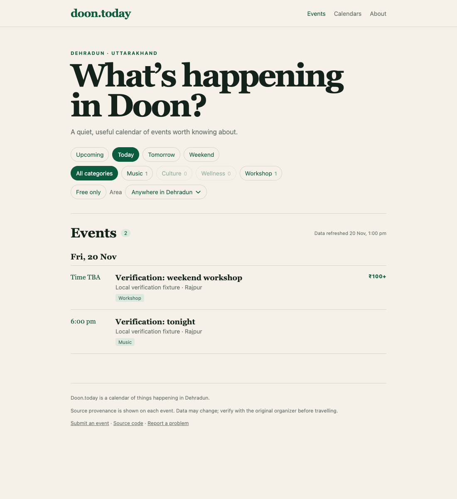
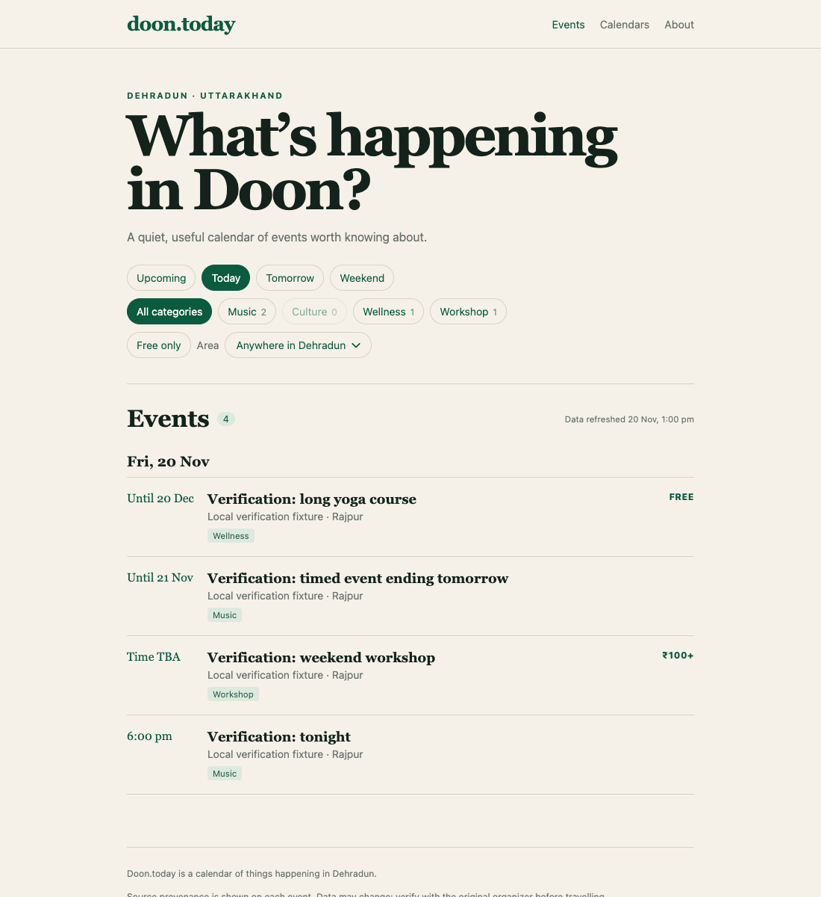

# Issue #22 — ongoing events under today

Direct Chromium screenshots from localhost production builds, captured on 26 October 2026. The browser clock replays 20 November 2026 at 13:00 IST; viewport 1100×1200, timezone Asia/Kolkata. Events are explicitly labelled local verification fixtures.

- Before: main at `c44085b`, localhost:4431. Today shows only two events starting on 20 November, missing the ongoing course and timed event.
- After: fix at `8928c4b`, localhost:4432. Today shows all four matching events, with the course and timed event under today's heading and labelled `Until 20 Dec` and `Until 21 Nov`.
- The static builds were produced on 26 October, so the after screenshot also verifies regrouping a page built before the simulated visit.

The dataset includes a course from 31 October through 20 December; a date-only workshop from 20 through 22 November; a timed event from 19 November 22:00 through 21 November 10:00 IST; an expired event; a future event; tonight's event; and a Saturday concert.

Browser assertions passed at 1100px and 390px in Kolkata, Los Angeles, and Kiritimati: Today/Tomorrow/Weekend range matching, no past headings, Until labels, category/price/area intersections, unique counts, shared URL reloads, and revisits on Saturday and Sunday. Full suite: 127 passed in both default and Los Angeles timezones. Type checks, data validation, and production builds passed.

| Before | After |
| --- | --- |
|  |  |
