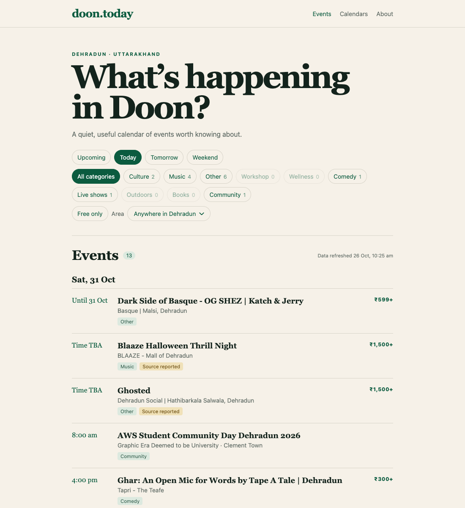
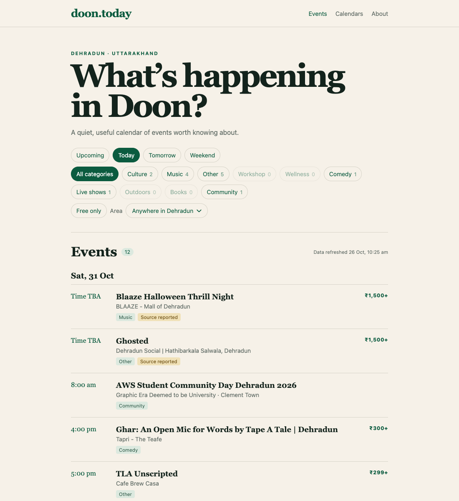

# PR #34 — early-morning finish regression

Addresses https://github.com/srijan-kapoor/doon.today/pull/34#issuecomment-6433177951.

Direct Chromium screenshots captured on 27 October 2026 from localhost production builds of `992f3c03178643b8b562b34cfa6f19206967beca` (before, port 4441) and `d7523583440e68bacb20916b92aa68c6689f4447` (after, port 4442). Both use the same committed event data, `TZ=UTC` builds, a 1100×1200 viewport, browser timezone Asia/Kolkata, and a browser clock replaying `2026-10-31T13:00:00+05:30`. No event records or screenshot pixels were edited.

The real Dark Side of Basque listing starts `2026-10-30T14:30:00.000Z` (30 October, 8pm IST) and ends `2026-10-30T19:30:00.000Z` (31 October, 1am IST).

| Before | After |
| --- | --- |
|  |  |

On `/?when=today`, before shows the party as `Until 31 Oct` with 13 events. After excludes it and shows 12 events; all other visible listing titles are unchanged. Both captures produced zero JavaScript exceptions.

## Test matrix

All timed examples start at 8pm IST on 30 October unless stated otherwise.

| End or scenario | Expected and verified |
| --- | --- |
| Midnight, 1am, or 05:59:59.999 IST on 31 October | Last listing day is 30 October; no next-day ongoing row |
| Exactly 06:00 IST | Last listing day is 31 October |
| 10:00 IST | Last listing day is 31 October |
| 1am IST written as UTC, -04:00, or an offset-less IST time | Same previous-night result |
| Date-only end `2026-10-31` | 31 October stays inclusive |
| Starts at 2am and ends at 3am on 31 October | Start day is retained; range never ends before it starts |
| Real party on 30 October | Still listed with its original 8pm start |
| Real party on 31 October, Upcoming/Today/Weekend | Absent |
| Real 300-hour yoga course, viewed on 20 November | Still visible in Today/Tomorrow/Weekend with `Until 4 Dec` |

The real-data browser checks passed in Kolkata, Los Angeles, and Kiritimati. Unit regressions failed before the fix and pass afterward. Full suite: 128 passed in both the default timezone and America/Los_Angeles. New ongoing-event tests also passed on Node 22. Type check: no errors/warnings/hints; data validation: 48 events; UTC production build: passed.
