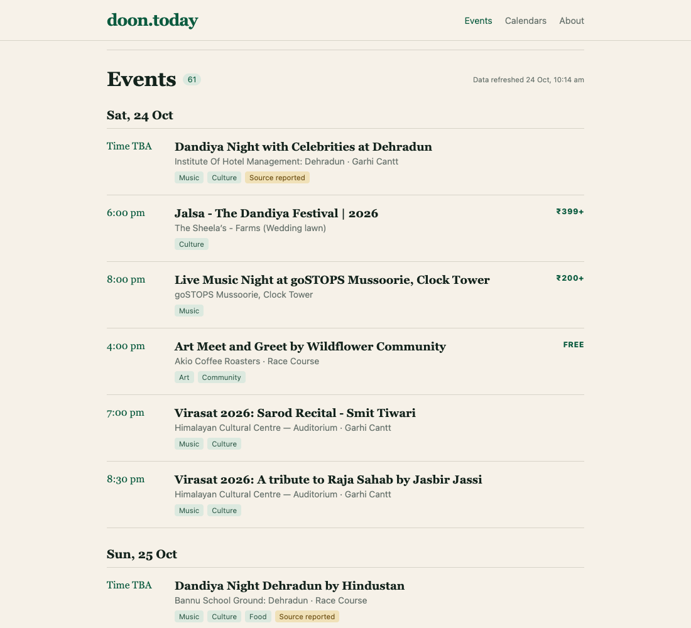
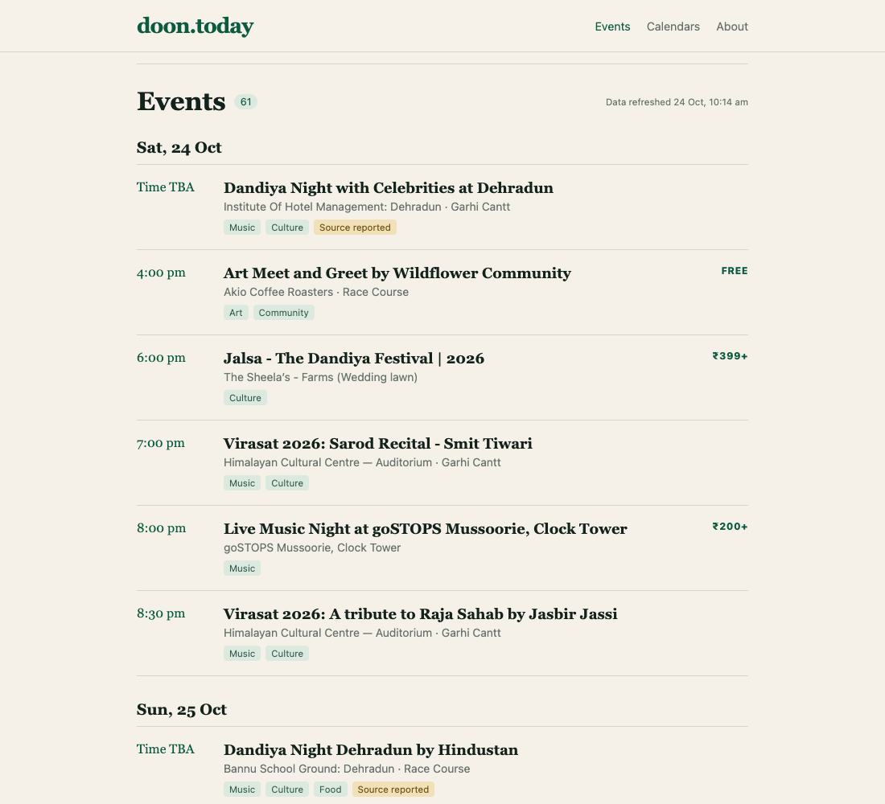
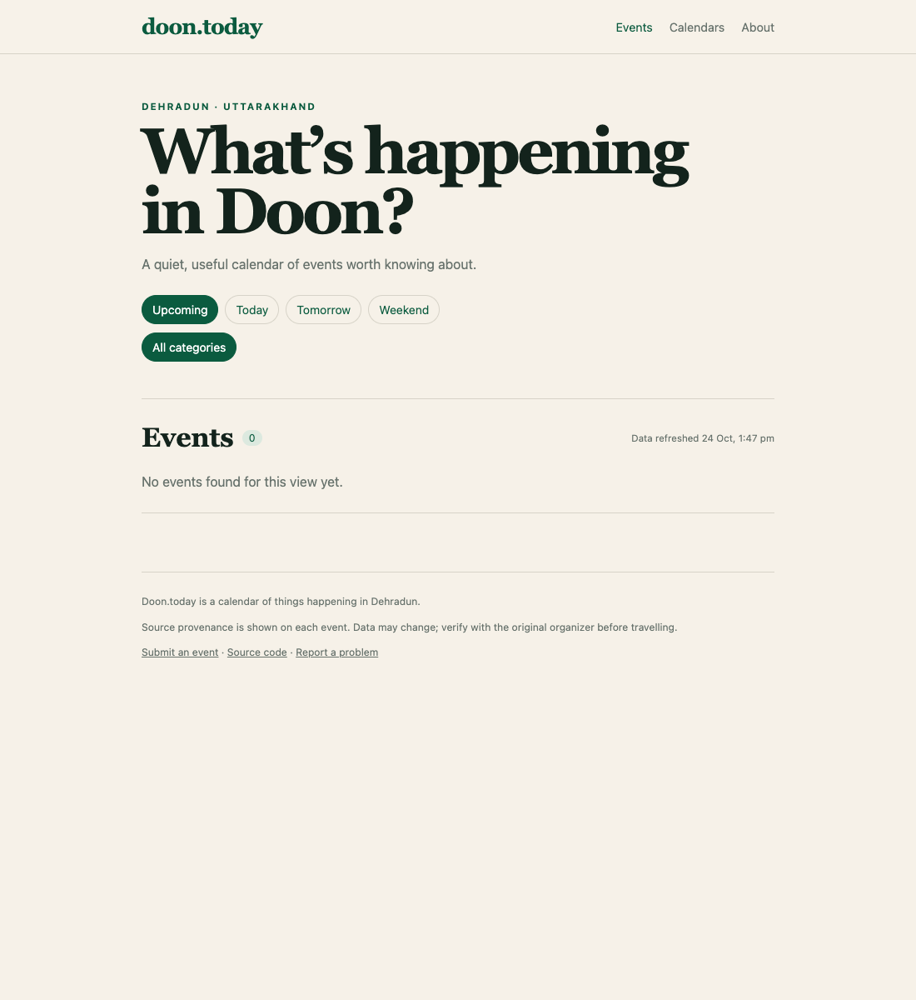
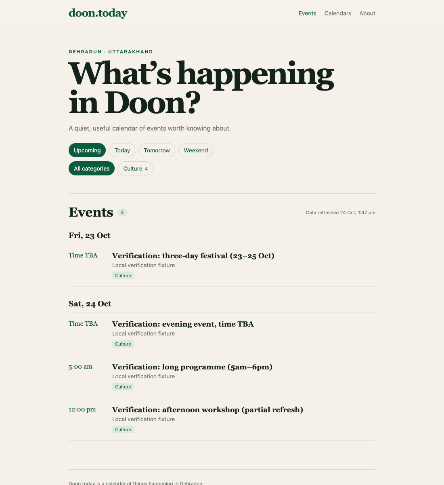
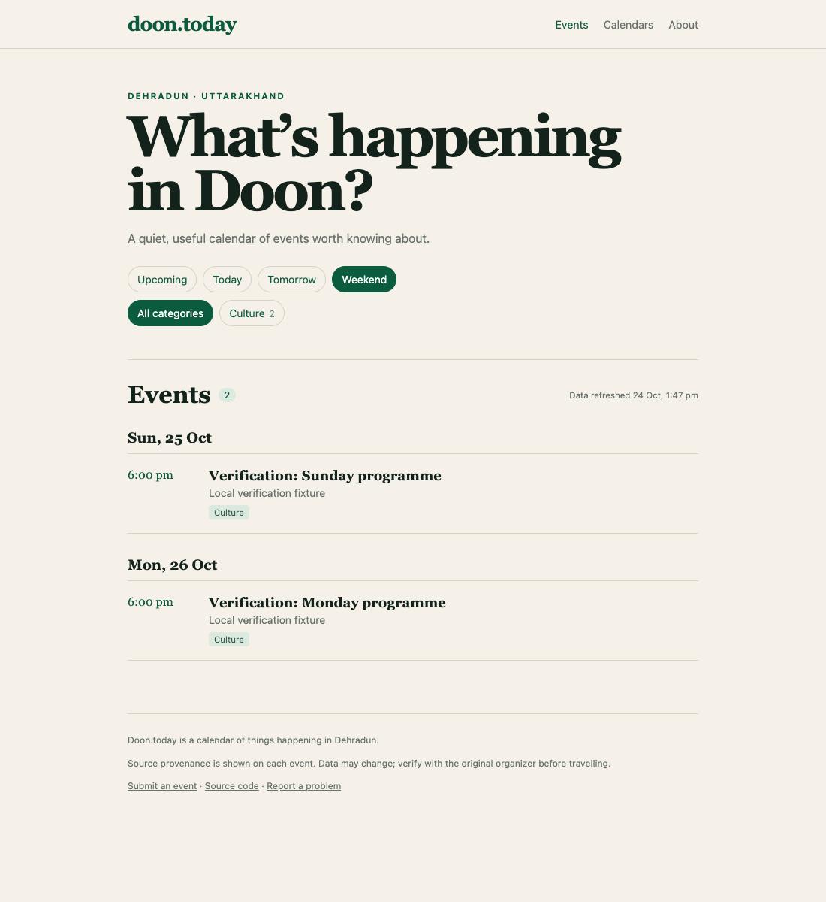
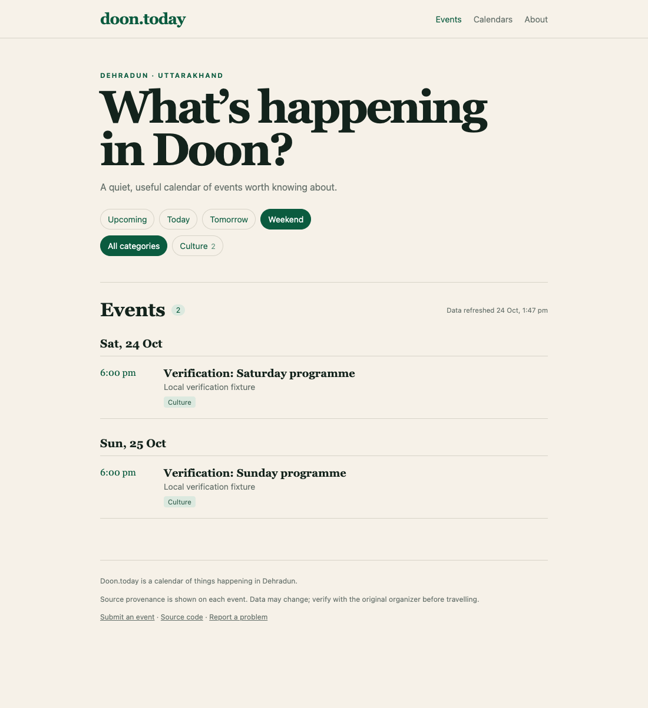
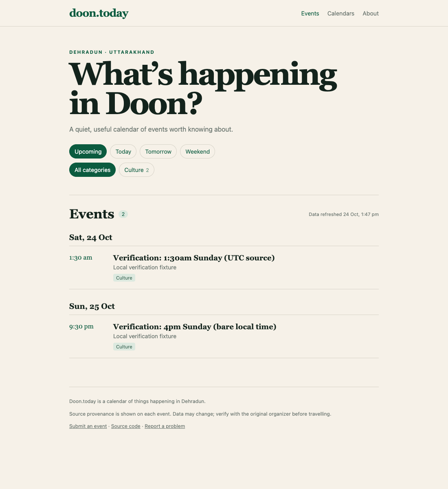
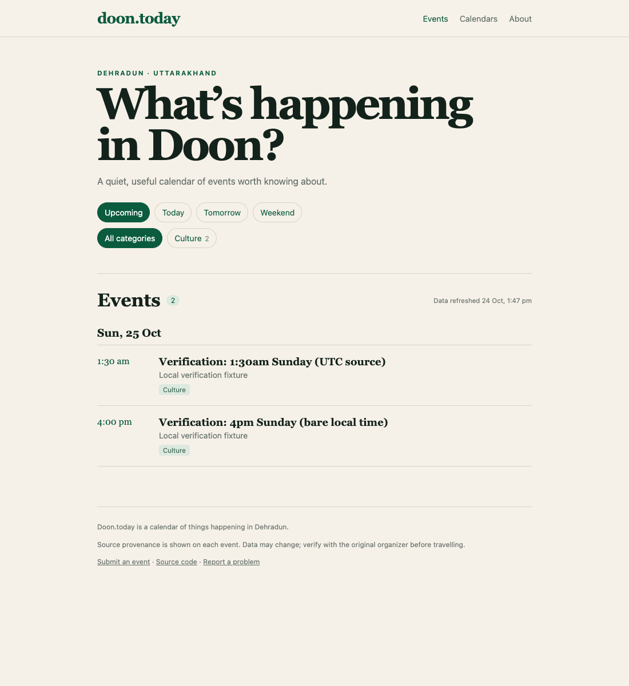

# PR #18 — localhost before/after verification

Captured on 26 October 2026 from unmodified source snapshots, built with `TZ=UTC` and served with Astro preview:

- Before: `9170ebd89d09646cab770d1e65936ae6a588bd7a`, the PR's base.
- After: `9dcd65d93743adce23db7152350daad5bfbb8fa5`, the PR's head.
- Before server: `http://127.0.0.1:4418/`; after server: `http://127.0.0.1:4419/`.
- Browser: Chromium, device scale factor 1; screenshots are direct browser captures with no overlays or retouching.
- Ordering uses the committed event data. Other comparisons use explicitly labelled local verification fixtures; no project event data was changed.
- Browser clock replayed 24 October 2026. Ordering: 12:00 IST; remaining scenarios: 13:47 IST. This makes the historical failures reproducible rather than dependent on the capture date.

| Check | Before | After |
| --- | --- | --- |
| Mixed-offset event ordering, actual committed listings | Time TBA, **6pm, 8pm, 4pm, 7pm**, 8:30pm | Time TBA, **4pm, 6pm, 7pm, 8pm**, 8:30pm |
| Expiry, actual merge execution frozen at 13:47 IST | All four fixtures removed, **0 events** | All four fixtures retained, **4 events** |
| Weekend, browser timezone America/Los_Angeles, Saturday in IST | **Sunday 25 / Monday 26** | **Saturday 24 / Sunday 25** |
| IST date/time rendering, build timezone UTC | Sunday 1:30am grouped under **Saturday**; bare 4pm shown as **9:30pm** | Both grouped under **Sunday**; bare 4pm shown as **4pm** |

## Screenshot pairs

| Scenario | Before | After |
| --- | --- | --- |
| Ordering |  |  |
| Expiry |  |  |
| Weekend |  |  |
| Date/time rendering |  |  |

## Controlled expiry fixtures

The production `mergeAndWrite` function ran separately against the before and after snapshots with Date frozen at `2026-10-24T13:47:00+05:30`:

1. Date-only evening event on 24 October, time TBA.
2. Date-only festival from 23 through 25 October, inclusive.
3. Timed programme on 24 October from 05:00 through 18:00 IST.
4. Workshop starting at 12:00 IST, seeded in stored data but absent from this partial refresh; still within the existing six-hour grace.

The first three were returned by the source. The fourth exercises stored-event retention. Before output: no events. After output: all four events.

## Other controlled fixtures

- Weekend: three events, one each at 18:00 IST on Saturday 24, Sunday 25, and Monday 26 October. Clicked the actual Weekend button in both versions.
- Rendering: one UTC event at `2026-10-24T20:00:00.000Z` (Sunday 01:30 IST) and one bare local timestamp `2026-10-25T16:00:00` (Sunday 16:00 IST).

Browser assertions verified the visible rows, dates, and times before each screenshot. The fixture pages produced no JavaScript exceptions. The full head-revision test suite was rerun: 97 passed, 0 failed. Both snapshot production builds passed for each captured dataset.
